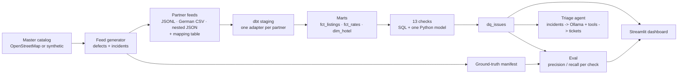

# Hotel Content Quality

[](https://github.com/AnasMehfooz/hotel-content-quality/actions/workflows/ci.yml)

A data-quality pipeline for hotel listings. Three partners send daily feeds for hotels in Köln
and Düsseldorf, each in its own format and with its own mistakes. The pipeline loads the feeds
with dbt and DuckDB, runs 13 data-quality checks, scores every check against known ground truth,
and hands incidents to a local LLM that investigates them with SQL tools and drafts tickets.

Stack: Python 3.12 · dbt-core + DuckDB · Dagster · pandas · rapidfuzz · Ollama · Streamlit ·
pytest · Docker · GitHub Actions.

## What makes it different

- **Measured checks.** The feed generator injects defects and writes a ground-truth manifest,
  so each check has a precision and recall, not just a row count.
- **Realistic data.** Real hotels from OpenStreetMap (or an offline synthetic catalog), three
  partner formats (JSON lines, a German CSV with decimal commas, nested JSON with prices in
  cents), a mapping table, a trade fair that legitimately triples hotel rates, and three
  systemic incidents where a partner's export breaks for a few days.
- **An agent with an evaluation.** Issues are grouped into incidents deterministically first.
  Only then does an LLM investigate with read-only SQL tools and return a schema-validated
  ticket, which is graded against the injected incidents.

## Architecture



Dagster runs the whole graph as assets (every dbt model is an asset, every dbt test an asset
check) on a daily schedule. Details and design decisions: [docs/architecture.md](docs/architecture.md).

## Quick start

Install [uv](https://docs.astral.sh/uv/), then, from this folder:

```powershell
# Windows PowerShell (macOS/Linux: curl -LsSf https://astral.sh/uv/install.sh | sh)
powershell -ExecutionPolicy ByPass -c "irm https://astral.sh/uv/install.ps1 | iex"

uv sync                     # Python 3.12 + all dependencies into .venv
uv run hcq demo             # catalog -> 14 days of feeds -> dbt build -> scoreboard
uv run hcq dashboard        # http://localhost:8501
```

On Windows you can also double-click `start.bat`: it installs uv if needed, runs `uv sync` and
`hcq demo`, and opens the dashboard.

`hcq demo` uses the offline synthetic catalog. For real hotels, run
`uv run hcq demo --source osm` (needs internet; queries the public Overpass API).

| Command | What it does |
|---|---|
| `hcq reference [--source osm\|synthetic]` | Build the master catalog, validated on ingest |
| `hcq generate [--days 14] [--seed 42]` | Simulate partner feeds with labelled defects |
| `hcq build [-s selector]` | `dbt build`: models, seeds and tests |
| `hcq progress` | Precision and recall of every check, and what is left to build |
| `hcq sql "select ..."` | Query the warehouse read-only |
| `hcq triage` | Group issues into incidents, let the local LLM draft tickets |
| `hcq eval-agent` | Grade the tickets against the injected incidents |
| `hcq dashboard` | Streamlit dashboard |
| `hcq orchestrate` | Dagster UI on http://localhost:3000 with the daily schedule |
| `hcq doctor` | Check Python, data, warehouse and Ollama |

With Docker: `docker compose up --build` starts Dagster on port 3000 and the dashboard on 8501.
Ollama stays on the host, where it can use the GPU.

## Checks

| Dimension | Checks |
|---|---|
| Completeness | `MISSING_REQUIRED` |
| Validity | `ENCODING_MOJIBAKE`, `STAR_INVALID`, `PHONE_INVALID`, `URL_INVALID` |
| Consistency | `ADDRESS_CITY_MISMATCH`, `STAR_CONFLICT` |
| Accuracy | `GEO_SWAPPED`, `GEO_OFFSET`, `WRONG_MAPPING` |
| Timeliness | `STALE_LISTING` |
| Uniqueness | `DUPLICATE_LISTING` (Python: blocking, fuzzy matching, optional embeddings) |
| Plausibility | `PRICE_OUTLIER` (market-adjusted, so a trade fair is not an outlier) |

What each one catches, how it is injected and where the traps are:
[docs/defect-catalog.md](docs/defect-catalog.md).

## Results

<!-- Replace this table with `hcq progress` output once your checks pass. -->

| Check | Precision | Recall | Target |
|---|---|---|---|
| `MISSING_REQUIRED` | 1.000 | 1.000 | 0.95 / 0.95 |
| `GEO_SWAPPED` | 1.000 | 1.000 | 0.95 / 0.95 |
| *11 more checks* | | | |

## Project layout

```
src/hcq/
  reference/      master catalog: Overpass client, synthetic catalog, validation + quarantine
  generator/      partner profiles, defect catalog, simulation engine, feed writers
  dedup/          duplicate detection (Python model behind DUPLICATE_LISTING)
  agent/          incidents, tools, Ollama client, ticket schema, evaluation
  orchestration/  Dagster definitions
  dashboard/      Streamlit app
  cli.py          the hcq command
dbt/
  models/staging/       one adapter per partner format
  models/intermediate/  union, city normalisation, mapping + master join
  models/marts/         fct_listings, fct_rates, dim_hotel
  models/dq/            checks, dq_issues, dq_daily_summary
  models/eval/          scoring against the ground truth
tests/            unit, pipeline and acceptance tests
docs/             architecture, defect catalog, partner feeds, agent, interview prep
```

## Data

Hotel names, addresses and coordinates come from OpenStreetMap (© OpenStreetMap contributors,
[ODbL](https://opendatacommons.org/licenses/odbl/)) when you use `--source osm`; the default
catalog is invented. Partner feeds, prices, mappings and defects are simulated. Nothing in
this repository describes a real hotel's prices or a real partner's data quality.
Generated data stays out of git; `hcq demo` recreates it in seconds.

## License

MIT
