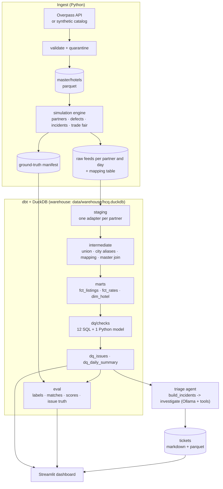

# Architecture

## Data flow

Dagster wraps everything as one asset graph (`src/hcq/orchestration/definitions.py`):
`master/hotels` -> eight raw-feed assets -> one asset per dbt model -> `triage_tickets`, with
every dbt test attached as an asset check and a daily schedule at 06:30 Europe/Berlin.

## Layers and grains

| Layer | Models | Grain |
|---|---|---|
| staging | `stg_<partner>__listings`, `stg_<partner>__rates`, `stg_mapping__listings`, `stg_master__hotels` | as delivered |
| intermediate | `int_listings__unioned`, `int_listings__enriched`, `int_rates__unioned` | snapshot × partner × listing (× stay date) |
| marts | `fct_listings`, `fct_rates`, `dim_hotel` | same; `dim_hotel` one row per master hotel |
| dq | one model per check, `dq_issues`, `dq_daily_summary` | one row per issue |
| eval | `eval_labels`, `eval_matches`, `eval_check_scores`, `eval_issue_truth` | per label / per check |

## Design decisions

**DuckDB as the warehouse.** One file, no server, the same SQL locally, in CI and in Docker.
External sources read the raw files in place (`read_json`, `read_csv`, `read_parquet`) with
explicit column types, so schema drift fails loudly in staging instead of silently downstream.
In production the same dbt project would point at Postgres, BigQuery or Snowflake.

**One staging model per partner.** Partner formats differ in structure (flat, CSV, nested),
number formats (decimal comma, cents), encodings of the same fact (Superior as `4S` or `4.5`)
and timestamps (ISO, `dd.mm.yyyy`, epoch). Each adapter handles one partner's quirks and
nothing else, so a format change touches exactly one file.

**Staging parses, checks judge.** Staging converts formats into types but never decides what is
valid: an out-of-range star rating still parses to `7`. That keeps raw evidence available to the
checks and makes every judgement visible in exactly one place.

**A contract for checks.** Every SQL check has an enforced dbt model contract with the same nine
columns, and `dq_issues` unions whatever `var('dq_checks')` lists. Adding a check is one model,
one YAML entry and one seed row. A `unique` test on `issue_id` catches checks that emit the same
issue twice.

**Ground truth through simulation.** Real feeds have no labels, so a check's quality is usually
anecdotal. The generator injects every defect deliberately and records it, which turns "does
this check work?" into precision and recall per check, per day. The simulation is deterministic
(`seed`, window), so every run and every test is reproducible.

**Realistic noise, not just defects.** Legitimate variation is what makes checks hard:
coordinates that differ by up to 90 m, one-star disagreements, partner-specific name styles,
mobile and central-reservation phone numbers, a trade fair that triples Köln rates. A check that
ignores this fails its precision target.

**Systemic incidents.** Three partner exports break for a few days (swapped columns, units,
encoding). Background defects of the same field group are suppressed on those rows so every
label stays unambiguous.

**Deterministic before generative.** The agent's grouping and spike detection are plain pandas;
the LLM only investigates and writes. Ticket fields the code already knows are set by the code,
the rest is constrained by a JSON schema (Ollama structured output) and validated with Pydantic.

**dbt runs as a subprocess.** The CLI and tests run dbt in a separate process, so DuckDB's file
lock is released when dbt exits and never collides with a read-only connection in the parent.
The dashboard opens short read-only connections and retries while dbt holds the write lock.

## What would change in production

- Raw feeds from object storage (S3/GCS) with arrival sensors instead of a simulator.
- Incremental models on `snapshot_date`, and snapshot (SCD2) tables for listings.
- A shared warehouse, with Dagster on Postgres-backed storage and separate webserver/daemon.
- Alerting from `triage_tickets` to the team's channel, and a feedback loop where humans label
  tickets, giving the agent eval real ground truth.
- Data contracts with partners, so schema changes are announced instead of discovered.
